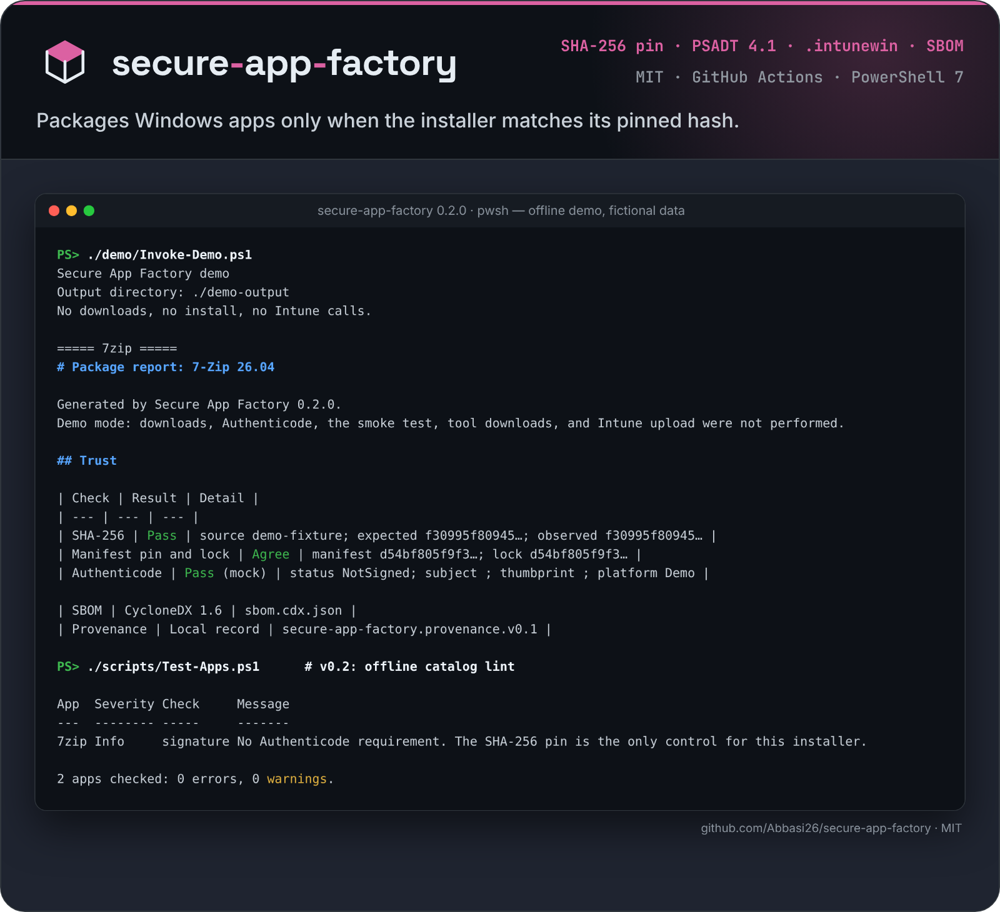

<p align="center">
  <picture>
    <source media="(prefers-color-scheme: dark)" srcset="docs/assets/logo-dark.svg">
    <source media="(prefers-color-scheme: light)" srcset="docs/assets/logo-light.svg">
    
  </picture>
</p>

<p align="center">Packages Windows apps only when the installer matches its pinned hash.</p>

<p align="center">
  
</p>

# Secure App Factory

[](https://github.com/Abbasi26/secure-app-factory/actions/workflows/package.yml)

Secure App Factory is a GitHub Actions template and a PowerShell 7 module that builds a Windows package from a pinned vendor installer: it checks the SHA-256 and the Authenticode policy, wraps the file with PSAppDeployToolkit 4.1, and can produce an `.intunewin`, a CycloneDX SBOM, and a local provenance record.

## The problem

A packaging script that downloads "the latest 7-Zip" will wrap a different file the next time the vendor ships a release. The official 7-Zip 26.04 x64 executable is not Authenticode-signed, so a signature check alone cannot tell a reviewed build from a swapped one. The control that still works is a SHA-256 pin. `apps/7zip/app.yaml` pins `7z2604-x64.exe` to `d54bf805f9f3704d1e8db2fa3498ae7ef2df0312b40b558e7c71c734430a665d`, the digest GitHub publishes for that release asset. The build stops when the downloaded bytes do not match.

Notepad++ 8.9.8.1 x64 is signed. A signature that is merely "valid" is not enough after the publisher renews the leaf certificate. `apps/notepadpp/app.yaml` requires a valid Authenticode signature whose subject contains `NOTEPAD++` and whose leaf SHA-1 thumbprint is `1E8E0D13B608BA908572C1A129FAEC5D228DF8A2`. That leaf was issued by GlobalSign GCC R45 CodeSigning CA 2020 and is valid from 2025-10-09 through 2028-10-09. A different thumbprint fails the build until the manifest is reviewed and updated. A different file hash has to be updated in both the manifest and `lock.json`.

## Quickstart

The demo uses the fixtures in `demo/fixtures`. It does not download, install, or call Intune. PowerShell 7 is the only requirement.

```powershell
pwsh -NoLogo -File ./demo/Invoke-Demo.ps1
```

Reports are written to `demo-output/7zip/REPORT.md` and `demo-output/notepadpp/REPORT.md`. The same command is the Offline demo job in `.github/workflows/package.yml`.

## Real usage

Install nothing from a gallery to use the module. Import it from the repo:

```powershell
Import-Module ./src/SecureAppFactory/SecureAppFactory.psd1 -Force
```

Build one example on Windows. Each switch is a write or a download. Omitting them leaves the build as a local package folder plus a preview of the smoke test and the upload.

```powershell
pwsh -NoLogo -File ./scripts/Invoke-Package.ps1 `
  -App notepadpp `
  -Destination ./out/notepadpp `
  -IncludeToolkit `
  -DownloadContentPrepTool `
  -SmokeTest `
  -Force
```

| Switch | What it does |
| --- | --- |
| `-IncludeToolkit` | Downloads the pinned PSAppDeployToolkit 4.1.8 template zip, checks its SHA-256, and extracts it. The toolkit stays LGPL-3.0-or-later. |
| `-DownloadContentPrepTool` | Downloads the pinned Microsoft Win32 Content Prep Tool 1.8.7 tag archive, checks `IntuneWinAppUtil.exe`, and writes an `.intunewin`. Passing the switch means you accept [Microsoft's license terms](https://github.com/microsoft/Microsoft-Win32-Content-Prep-Tool/blob/v1.8.7/Microsoft%20License%20Terms%20For%20Win32%20Content%20Prep%20Tool.pdf). Windows only. |
| `-SmokeTest` | Runs the silent install, checks the detection rule, then uninstalls. Windows only. Default mode `Command` runs the vendor installer. `Toolkit` runs the generated PSADT script. |
| `-TrustOnFirstUse` | Writes `lock.json` only when no hash pin exists yet and the signature policy passed. Never overwrites a pin. |
| `-Upload` | Calls Microsoft Graph. Requires the three `SAF_INTUNE_*` variables below. Does not create an assignment. |
| `-Force` | Replaces an existing destination directory. Refuses the repository root and a drive root. |
| `-Demo` | Uses local fixtures. Cannot be combined with the switches above. |

The GitHub Actions workflow `.github/workflows/package.yml` runs Pester and the catalog check on `ubuntu-latest`, the offline demo, and both example apps on `windows-latest` with `-IncludeToolkit`, `-DownloadContentPrepTool`, and `-SmokeTest`. Artifacts include `REPORT.md`, `trust.json`, `sbom.cdx.json`, `provenance.json`, `intune-plan.json`, the PSADT folder, and the `.intunewin`.

### Manifest

`apps/<id>/app.yaml` is a small YAML dialect (maps, lists, strings, booleans, integers). Unknown keys are rejected. Tabs and duplicate keys are rejected. `<id>` is the directory name.

```yaml
name: Notepad++
version: "8.9.8.1"
publisher: NOTEPAD++
architecture: x64
source:
  type: url
  url: https://github.com/notepad-plus-plus/notepad-plus-plus/releases/download/v8.9.8.1/npp.8.9.8.1.Installer.x64.exe
  fileName: npp.8.9.8.1.Installer.x64.exe
trust:
  algorithm: SHA256
  value: 26f3bcced788fadbac4e7e577b430ea2ce6060cf3bcad993ef4612ecd7d743da
  signature:
    required: true
    subjectContains: NOTEPAD++
    thumbprint: 1E8E0D13B608BA908572C1A129FAEC5D228DF8A2
install:
  arguments: /S
uninstall:
  filePath: "{ProgramFiles}\\Notepad++\\uninstall.exe"
  arguments: /S
detection:
  type: file
  path: "{ProgramFiles}\\Notepad++\\notepad++.exe"
```

`source.type` may be `evergreen` instead of `url`. Set `source.application` to an Evergreen name. The module calls `Get-EvergreenApp` only when that command is already installed; it does not install gallery modules. The candidate must match `version` exactly. A newer release is a failure, not a silent upgrade. The downloaded file still has to match the hash pin.

`detection.type` is `file` or `registry`. `{ProgramFiles}`, `{ProgramFilesX86}`, and `{SystemRoot}` are the path tokens.

`lock.json` next to the manifest repeats the SHA-256. When both the manifest and the lock file have a hash, they must agree.

### Check the catalog

```powershell
pwsh -NoLogo -File ./scripts/Test-Apps.ps1
```

`Test-SafAppCatalog` reads every `apps/<id>` folder and downloads nothing. It reports:

| Severity | Examples |
| --- | --- |
| Error | YAML or schema errors, no SHA-256 pin, `trust.value` and `lock.json` disagree, a folder name `-App` cannot select |
| Warning | the URL and file name do not contain the version, a signature rule without a leaf thumbprint, a lock recorded for another URL, a fixed drive letter in a path, two apps with the same URL |
| Info | the hash pin is the only control (unsigned installer), an Evergreen source |

The script exits 1 on an error, or on a warning with `-FailOnWarning`. `-SummaryPath $env:GITHUB_STEP_SUMMARY` appends a Markdown table; the Catalog check job in the workflow does that on every pull request.

### Add an app

```powershell
New-SafAppManifest -Id example -Name "Example" -Version 1.2.3 -Publisher "Example Ltd" `
  -Url https://downloads.example.org/example-1.2.3-x64.exe -InstallerPath ./example-1.2.3-x64.exe `
  -InstallArguments "/S" -UninstallPath "{ProgramFiles}\Example\uninstall.exe" -UninstallArguments "/S" `
  -DetectionPath "{ProgramFiles}\Example\example.exe"
```

It writes `apps/example/app.yaml` and a matching `lock.json`. The SHA-256 comes from `-Sha256` (the digest the vendor publishes) or from `-InstallerPath`, a file you already downloaded and reviewed. It does not download anything. Add `-SignatureSubject` and `-SignatureThumbprint` for a signed installer. The manifest is checked against the schema before it is written. Use `-WhatIf` to preview and `-Force` to replace an existing app.

### Commands

| Command | Default behavior |
| --- | --- |
| `Get-SourceInstaller` | Downloads the pinned https URL, or copies a fixture when `-Demo` is set. Does not execute the file. |
| `Test-InstallerTrust` | Compares SHA-256 with the manifest, the lock, or an explicit expected hash, and evaluates the signature policy. |
| `New-PsadtPackage` | Writes `Invoke-AppDeployToolkit.ps1`, copies the installer under `Files/`, and writes `PACKAGE-NOTICE.txt`. Bundles the toolkit only with `-IncludeToolkit`. |
| `New-IntuneWinPackage` | Returns `Skipped` unless `-DownloadTool` or `-ToolPath` is set. |
| `New-PackageSbom` | Writes a CycloneDX 1.6 JSON document for the verified installer. |
| `New-PackageProvenance` | Writes `provenance.json` (`secure-app-factory.provenance.v0.1`) with the builder, installer digest, and invocation. It is not an in-toto statement and not a SLSA attestation. |
| `Test-PackageInstall` | Returns the install, uninstall, and detection commands. Executes them only with `-SmokeTest`. |
| `Get-IntuneUploadPlan` | Builds the Win32 app body. Does not call Graph. |
| `Send-IntunePackage` | Returns `Disabled` unless `-Upload` is set. |
| `New-PackageReport` | Writes `REPORT.md` from a pipeline result, including a failed one. |
| `Invoke-SafPipeline` | Runs the steps above and always attempts to write the report. |
| `Test-SafAppCatalog` | Reviews every `apps/<id>` folder offline and returns findings. |
| `ConvertTo-SafCatalogMarkdown` | Renders those findings as a Markdown table. |
| `New-SafAppManifest` | Writes `app.yaml` and `lock.json` for a reviewed installer. Refuses to overwrite without `-Force`. |

## Required permissions

Local build: read this repository and write the destination directory. No admin rights are required until `-SmokeTest`, which installs and then uninstalls the application under `Program Files` and must run elevated on Windows.

`-IncludeToolkit` needs outbound https to the pinned PSAppDeployToolkit release. `-DownloadContentPrepTool` needs outbound https to the pinned Microsoft tag archive. Both hashes are in `src/SecureAppFactory/data/external-tools.json`.

Intune upload is off by default. A manual run of the Package workflow uploads only when the `upload` input is true. The app registration uses client credentials and needs the application permission `DeviceManagementApps.ReadWrite.All` with admin consent. That permission can create and change Intune apps. Use a dedicated registration.

| Secret | Used as |
| --- | --- |
| `SAF_INTUNE_TENANT_ID` | Tenant id or domain in the token URL |
| `SAF_INTUNE_CLIENT_ID` | Client id |
| `SAF_INTUNE_CLIENT_SECRET` | Client secret |

The secret is sent to `https://login.microsoftonline.com` and is not written to the report or the result files. v0.1 creates a `win32LobApp`, uploads the encrypted content, and commits it through Graph beta. It does not assign the app to a group, a user, or all devices. If any secret is missing, no Graph call is made.

There is no telemetry. Data stays in the destination directory you pass.

## How to contribute

See [CONTRIBUTING.md](CONTRIBUTING.md). Run `pwsh -NoLogo -File ./scripts/Invoke-Tests.ps1` before sending a change. Security reports go through a private GitHub advisory; see [SECURITY.md](SECURITY.md).

## Roadmap

[ROADMAP.md](ROADMAP.md) has the plan and good first issues.

- Validate the generated PSADT script by running `-SmokeTest -SmokeTestMode Toolkit` in CI. v0.1's Windows job runs the vendor installer directly.
- Certificate authentication for Graph, as an alternative to the client secret.
- Update an existing Win32 app instead of creating a new one on every upload.
- MSI product-code detection.
- A MECM application object. v0.1 only produces a package folder you can point a MECM application at.
- Timestamp counter-signature checks, and a check of the vendor's published checksum signature where one exists.

## How this differs from existing tools

Secure App Factory is a pipeline template for one reviewed installer at a time. It is not a catalog, an endpoint agent, or a management module.

| Tool | What it is good at | What this template does not take from it |
| --- | --- | --- |
| [Winget-AutoUpdate](https://github.com/Romanitho/Winget-AutoUpdate) | Installs on the device and updates apps with winget on a schedule, including an Intune deployment path for the updater itself. | Nothing here runs on the endpoint or calls winget. The package is built before it is deployed, from a URL you pin. |
| [Evergreen](https://github.com/EUCPilots/evergreen-module) | Returns the current version and vendor download URL for a large set of enterprise apps (`Get-EvergreenApp`). | An Evergreen source is optional and must still match the pinned version and hash. This module does not install Evergreen and does not follow "latest". |
| [IntuneWin32App](https://github.com/MSEndpointMgr/IntuneWin32App) | Creates, publishes, assigns, and updates Win32 apps through Microsoft Graph, including dependencies and supersedence. | Upload here is one create-and-commit path, off by default, with no assignment. Use IntuneWin32App when you need the rest of the app lifecycle. |
| [PSAppDeployToolkit](https://github.com/PSAppDeployToolkit/PSAppDeployToolkit) | The deployment toolkit this template generates a v4 script for. 4.1.8 is LGPL-3.0-or-later. | The toolkit is not modified and is not stored in this repo. `-IncludeToolkit` extracts the pinned upstream template and replaces `Invoke-AppDeployToolkit.ps1` with the generated script. |
| [Chocolatey](https://docs.chocolatey.org/en-us/community-repository/community-packages-disclaimer/) | A package manager. Chocolatey itself tells organizations not to depend on the public community repository and to internalize packages they trust. | This template does not read `.nupkg` files or the community feed. It fetches the vendor installer named in the manifest. |
| [Patch My PC](https://patchmypc.com/) | A commercial catalog and publishing product for ConfigMgr, Intune, and WSUS, with support and broad application coverage. | Two example apps, no catalog, no SLA, and no claim to replace that product. The tradeoff is that every pin, download, and Graph call is visible in this repository. |

## Status

Version 0.2.0, early but usable. PowerShell packaging template. MIT licensed. Every push runs the test suite in GitHub Actions (`.github/workflows/package.yml`).

## Install

```sh
git clone https://github.com/Abbasi26/secure-app-factory && cd secure-app-factory
```

## Tests

```sh
pwsh -NoProfile -File ./scripts/Invoke-Tests.ps1
```

## License

The module, the generated deployment script, and this documentation are under the [MIT License](LICENSE), copyright Wasaf Abbasi.

PSAppDeployToolkit, when a build downloads it, remains under LGPL-3.0-or-later. `IntuneWinAppUtil.exe` is Microsoft software and is not redistributed here. The 7-Zip and Notepad++ installers are the vendors' own files; their SPDX ids are recorded in the manifests and the SBOM. `PACKAGE-NOTICE.txt` in a built folder states which of these landed in that folder.

## Kurzfassung

Secure App Factory ist eine offene Vorlage, mit der ein Windows-Installationspaket für Intune nachvollziehbar gebaut wird. Version 0.1 lädt einen festgelegten Hersteller-Installer, prüft SHA-256 und optional die Authenticode-Signatur, erzeugt ein PSAppDeployToolkit-Paket und auf Wunsch eine `.intunewin`-Datei, eine CycloneDX-SBOM und lokale Herkunftsdaten. Installation, Werkzeug-Downloads und der Intune-Upload passieren nur mit einem ausdrücklichen Schalter. Der Upload legt keine Zuweisung an. Der Demo-Modus läuft offline mit lokalen Testdateien und installiert nichts. Ab 0.2 prüft `scripts/Test-Apps.ps1` alle App-Manifeste offline (fehlende oder widersprüchliche Hash-Pins, Signaturregel ohne Thumbprint, URL ohne Version), und `New-SafAppManifest` legt ein neues, schema-geprüftes Manifest samt `lock.json` an, ohne etwas herunterzuladen.
