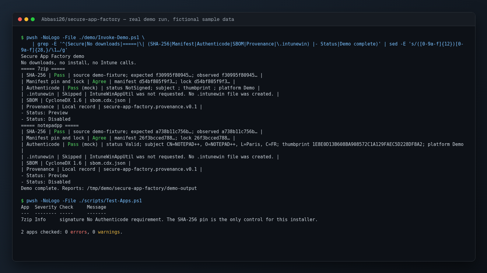

# Demo screenshot



`demo.png` (1600x900) is the unedited terminal output of a real demo run, rendered to an image on 2026-11-03. All hosts, users, devices and files in it are fictional sample data that ships with this repository. No network service or real system was involved.

Setup: PowerShell 7, from the repository root.

Commands, in the order shown in the image:

```text
$ pwsh -NoLogo -File ./demo/Invoke-Demo.ps1 \
    | grep -E '^(Secure|No downloads|=====|\| (SHA-256|Manifest|Authenticode|SBOM|Provenance|\.intunewin) |- Status|Demo complete)' | sed -E 's/([0-9a-f]{12})[0-9a-f]{28,}/\1…/g'

$ pwsh -NoLogo -File ./scripts/Test-Apps.ps1
```

Pipes such as `head`, `grep` or `sed` in the commands above only shorten the output so it fits on one screen. They are part of the shown command.
